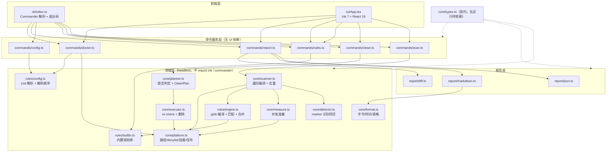
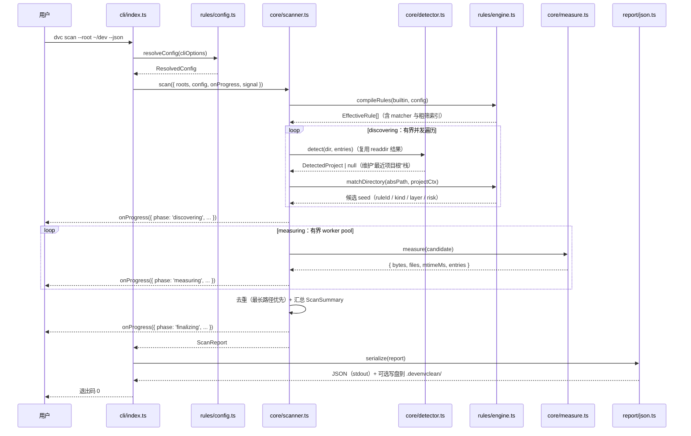
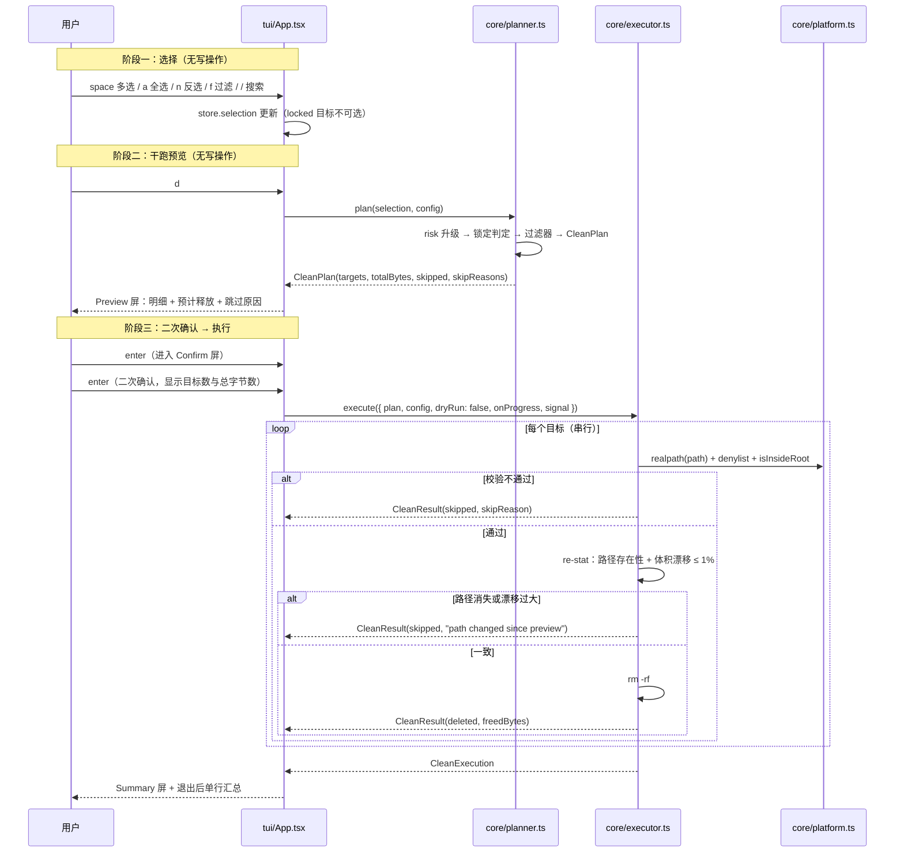
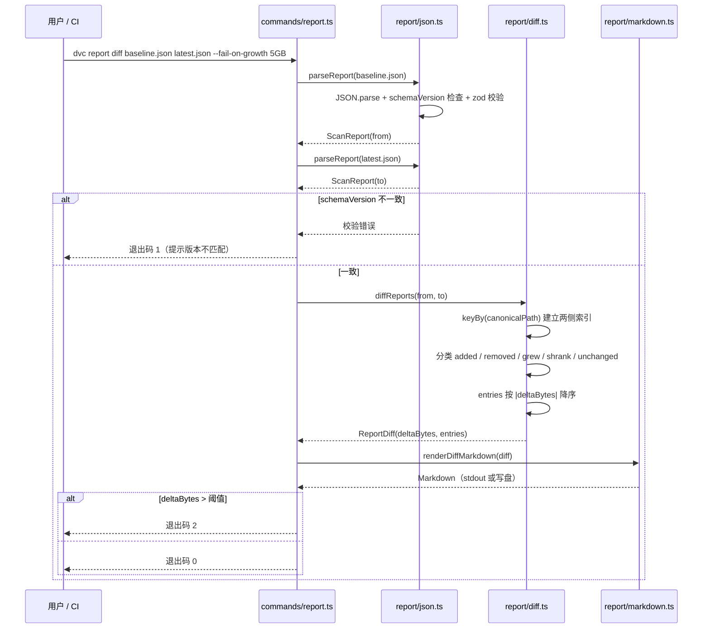

# DevEnvClean 技术设计文档

> 产品名：**DevEnvClean** ｜ npm 包名：`devenv-cleaner` ｜ 可执行文件名：`dvc`
> 数据契约唯一真源：`src/core/types.ts`。本文档中出现的所有结构名均引用该文件，不重新定义类型。
> 需求基线：`docs/requirements.md` ｜ 技术选型（已冻结）：Node.js >= 22 / ESM / TypeScript strict / Ink 7 + React 19 / Commander / fast-glob / zod / picocolors / tsup / vitest / pnpm
>
> 文档状态：待评审

---

## I. 设计目标与约束

### 1. 设计目标

1. **单一核心，双前端**：扫描、识别、度量、规则判定、计划、执行、报告全部实现于无 UI 依赖的 `src/core`、`src/rules`、`src/report`。CLI 与 Ink TUI 是两个平级前端，消费同一套 `commands` 服务，行为必须等价（FR-56）。
2. **默认安全，安全内建于核心**：dry-run 不是 UI 层的礼貌提示，而是 `core` 的一等公民——`CleanPlan` 的计算与执行完全分离，`execute` 只接受显式构造的计划（NFR-5）。
3. **契约先行**：`src/core/types.ts` 定义每一个跨模块边界的结构；报告是版本化契约（`SCHEMA_VERSION`），CI 可直接依赖（FR-57）。
4. **可解释**：每一个出现在屏幕上的目标都能回答"为什么是它、为什么这么大、为什么能删、为什么不能删"——对应 `ruleId`、`note`、`locked` / `lockedReason`。
5. **性能可预期**：核心扫描是 I/O 密集型有界并发任务，10 万目录 10 秒内完成（NFR-1），内存与文件数无关（NFR-3）。

### 2. 硬约束

| 约束 | 内容 | 设计影响 |
| --- | --- | --- |
| 运行时 | Node.js >= 22，纯 ESM | 无 `require`、无 `__dirname`（用 `import.meta.url`）；无原生依赖，`fs.promises` + `node:fs` 同步小操作 |
| 类型 | TypeScript strict | 所有外部输入（配置文件、报告文件、CLI 参数）在边界处经 zod 校验后进入类型系统 |
| 依赖面 | 仅 Commander / fast-glob / zod / picocolors / Ink / React | 不引入 glob 之外的匹配库；不引入 `du` 类外部二进制 |
| 平台 | macOS / Linux / Windows | 路径、大小写、挂载点、信号差异全部收敛在 `core/platform.ts` |
| 破坏性 | 只删目录，不删文件；无撤销 | 执行器只有 `rm -rf` 语义；`rm` 前必过 re-check 与包含性校验 |
| 契约 | 跨模块类型只在 `types.ts` 定义 | 新增结构先改契约再改实现 |

### 3. 非目标

不做回收站、不做 GUI、不做云同步、不做文件级删除、不修改包管理器状态、不做后台常驻（详见 `requirements.md` 第 VIII 节）。

---

## II. 总体架构

### 1. 分层图



### 2. 依赖方向

单向：`cli` / `tui` → `commands` → `core` / `rules` / `report` → `core/types.ts`。

- `core/**` **不得** import `ink`、`react`、`commander`、`picocolors`（`picocolors` 只允许出现在 `core/format.ts` 的表格渲染与 `tui/`、`commands/` 的输出层；`core` 内部结构不携带颜色）。
- `rules/**` 只依赖 `core/types.ts` 与 `core/platform.ts`（路径语义），不依赖 `core/scanner.ts`，避免环。
- `report/**` 依赖 `core/types.ts` 与 `core/format.ts`。
- `commands/**` 是**唯一**允许同时接触"领域 + 输出 + 退出码"的层。TUI 调用 `commands` 的服务函数（而非 `cli` 的参数解析），因此 TUI 不需要 Commander 的 `program` 对象。
- CI 中以 `eslint-plugin-import` 的 `no-restricted-imports` 规则固化该约束（NFR-16）。

### 3. 核心无头性

`core` 的每个入口都是纯异步函数或类，通过参数接收 `ResolvedConfig` 与 `AbortSignal`，通过回调返回 `ScanProgress` / `CleanResult`。它不知道终端宽度、不知道颜色、不知道 TUI 是否存在。`dvc scan --json` 与 TUI 的扫描屏调用的是同一个 `scan()`。

---

## III. 模块划分与职责

### 1. `src/core/types.ts`

- **职责**：跨模块数据契约的唯一定义处；导出 `SCHEMA_VERSION`。
- **输入 / 输出**：无运行时输入输出，仅类型与常量。
- **依赖**：无（编译期可被所有模块依赖）。
- **注意点**：`ResolvedConfigSnapshot` 刻意与 `ResolvedConfig` 分离——报告消费者不能依赖编译后的 matcher 等运行时字段；`CleanRule` 必须是可 JSON 序列化的纯数据，规则匹配所需的 `RegExp` 一律由 `rules/engine.ts` 在执行时编译并缓存，不入契约。

### 2. `src/core/platform.ts`

- **职责**：所有平台相关语义的收敛点。
- **输入**：路径字符串、`ResolvedConfig`、平台信息。
- **输出**：规范化绝对路径；`isProtected(path)`；`isWhitelisted(path, whitelist)`；`isInsideRoot(path, root)`；`realpathSafe(path)`；`sameFileSystem(a, b)`（比较 `st_dev`）；`isCaseInsensitiveFs(root)`；`resolveHome(p)`；`trashSupported()`；信号到 `AbortSignal` 的桥接。
- **依赖**：`node:fs/promises`、`node:path`、`node:os`、`core/types.ts`。
- **关键算法 / 注意点**：
  1. **denylist**：内置保护路径按平台构造（POSIX：`/`、`/System`、`/usr`、`/etc`、`/var`、`/bin`、`/sbin`；Windows：`C:\`、`C:\Windows`、`C:\Program Files`），再加用户家目录本身与常见不可再生目录（`Documents`、`Desktop`、`Downloads`、`Pictures`、`Library`）。判定用"路径前缀且位于分隔符边界"而非裸 `startsWith`（避免 `/Users/me` 匹配 `/Users/megan`）。
  2. **大小写策略**：先探测根所在卷的大小写敏感性（在卷根写入临时文件再以不同大小写 `stat`，结果缓存于进程内）；不敏感时所有比较统一转小写。
  3. **包含性校验**：`realpath` 双方后比较；Windows 上处理盘符大小写与 UNC 前缀。
  4. **realpath 缓存**：一次执行内以 `Map<string,string>` 缓存，避免对同一路径重复系统调用；同时缓存结果带 TTL 无意义（进程生命周期短），故只缓存不失效。

### 3. `src/core/format.ts`

- **职责**：所有"人类可读"的格式化与终端表格渲染。
- **输入**：字节数、毫秒数、epoch 毫秒、`CleanTarget[]`、`ScanSummary`、终端宽度、颜色开关。
- **输出**：字符串 / 表格行数组。
- **依赖**：`picocolors`、`core/types.ts`。
- **关键算法 / 注意点**：
  1. `formatBytes` 采用二进制单位（KiB/MiB/GiB）但显示为 `KB/MB/GB` 以符合开发者直觉，保留 1 位小数；≥ 1 TB 时保留 2 位。
  2. 宽度自适应：先算出各列自然宽度，若总和超过 `columns`，按优先级（`note` → `files` → `age` → `risk`）依次丢弃列（FR-55/NFR-13）。
  3. 颜色只做强调不做语义：风险同时输出文本标签（`[safe]` `[low]` `[medium]` `[high]`）与锁定原因文本，保证 `NO_COLOR` 下信息不丢失（NFR-14）。

### 4. `src/core/detector.ts`

- **职责**：通过 marker 文件识别项目与其生态。
- **输入**：目录的条目名集合（由 scanner 在 `readdir` 时顺带提供，避免二次 `readdir`）、目录绝对路径。
- **输出**：`DetectedProject | null`（单目录视角）与 `EcosystemDefinition[]`（生态字典）。
- **依赖**：`core/types.ts`、`core/platform.ts`。
- **关键算法 / 注意点**：
  1. 生态字典为纯数据表：`{ id, name, markers: string[], globMarkers?: string[] }`。v1 覆盖 `node`（`package.json`、`pnpm-workspace.yaml`、`pnpm-lock.yaml`）、`rust`（`Cargo.toml`）、`go`（`go.mod`）、`python`（`pyproject.toml`、`requirements.txt`、`setup.py`、`Pipfile`）、`java`（`pom.xml`、`build.gradle`、`build.gradle.kts`）、`ruby`（`Gemfile`）、`php`（`composer.json`）、`dotnet`（`*.csproj`、`*.sln`）、`cpp`（`CMakeLists.txt`）。
  2. 一条目录可命中多个生态，`ecosystems` 按字典顺序稳定排列，保证报告可复现。
  3. 检测是**单遍**的：scanner 在遍历时对每个目录拿到 `Dirent[]`，同时喂给 detector 与规则引擎，避免为识别项目再走一次目录树。
  4. **新增生态只改本文件**的生态字典（见第 XII 节）。

### 5. `src/core/measure.ts`

- **职责**：度量单个候选目录的递归 `bytes`、`files`、`mtimeMs`，并处理硬链接去重与设备边界。
- **输入**：候选目录绝对路径、`ResolvedLimits`、共享的 `SeenInodes` 集合、`AbortSignal`。
- **输出**：`{ bytes, files, mtimeMs, entries, truncated }`（内部结构；最终由 scanner 组装为 `CleanTarget`）。
- **依赖**：`node:fs/promises`、`core/platform.ts`、`core/types.ts`。
- **关键算法 / 注意点**：
  1. **并发池**：自实现的有界 worker pool（无第三方依赖），任务粒度是"一个待展开目录"。`concurrency` 默认 `min(32, max(8, cpus × 4))`（NFR-2），可用 `limits.concurrency` 覆盖。
  2. **一次 `readdir` 拿 `Dirent`**：使用 `withFileTypes: true`，从 `Dirent` 直接区分 `isDirectory` / `isSymbolicLink` / `isFile`，避免对每个条目 `stat`。
  3. **只对文件 `stat`**：目录大小不计入（与 `du` 的 `--apparent-size` 口径对齐，且避免目录 inode 的块分配污染），文件用 `stat` 取 `size` 与 `nlink`/`ino`。
  4. **硬链接去重**：`nlink > 1` 的文件以 `dev:ino` 为键登记到 `SeenInodes`，已登记则该文件计 0 字节但仍计入 `files`？——**不计**，`files` 亦只统计首次出现的 inode，保持"逻辑文件数"与"逻辑字节数"口径一致。
  5. **设备边界**：进入子目录前比较 `st_dev`，变化即停止深入并把该子目录计为"跨挂载点跳过"（避免把外置盘/网络盘内容算进本目标的体积）。
  6. **错误容忍**：`EACCES` / `EPERM` / `ENOENT` 记入 skipped 计数并继续；`EMFILE` / `ENFILE` 采用指数退避重试（最多 3 次），避免 fd 耗尽导致整轮失败。
  7. **失控保护**：度量共享 scanner 的 `maxDirectories` 预算，超出即抛出一个被 scanner 捕获的 `BudgetExceeded` 内部信号，保证不会无限深入。
  8. **不跟随 symlink**：`Dirent.isSymbolicLink()` 为真则完全跳过（既不 `stat` 其大小，也不深入），这是 FR-7 与 NFR-6 的实现点。

### 6. `src/core/scanner.ts`

- **职责**：扫描编排——遍历目录树、调用 detector / engine / measure、去重、组装 `ScanReport` 的原始素材与 `ScanSummary`。
- **输入**：`ScanOptions`（`roots`、`config`、`onProgress?`、`signal?`）。
- **输出**：`ScanReport`。
- **依赖**：`core/detector.ts`、`core/measure.ts`、`core/platform.ts`、`rules/engine.ts`、`core/types.ts`。
- **关键算法 / 注意点**：
  1. **两阶段**：`discovering`（遍历 + 识别 + 收集候选目录）→ `measuring`（对候选并发度量）→ `finalizing`（去重、汇总、排序），与 `ScanProgress.phase` 一一对应（FR-10）。
  2. **候选收集只看目录名**：规则匹配在"目录绝对路径"上进行（FR-4），所以遍历时必须对每个目录做一次规则判定。为控制成本，规则引擎把所有 pattern 编译成少数几个前缀/后缀粗筛器，粗筛不通过则不做精确匹配。
  3. **去重"最长路径优先"**：候选按路径长度降序 → 依次加入结果集，加入前检查结果集中是否已存在"以本路径为前缀的严格祖先"；若本路径的某个祖先是其他候选，则丢弃该祖先（见第 V.5 节）。
  4. **汇总**：`byLayer`（`LayerSummary[]`）恒含 4 个 layer（缺失补 0）；`byRule`（`RuleSummary[]`）与 `byEcosystem`（`EcosystemSummary[]`）按 bytes 降序，两者的 `reclaimableBytes` 只累计未锁定目标；`largestTargetBytes` 取 `targets[0].bytes`（已排序）或 0。
  5. **时间与计数**：`durationMs` 用 `performance.now()`；`directoriesVisited` / `skippedDirectories` 为整数计数器。
  6. **中断语义**：`signal.aborted` 在每个 worker 的任务边界检查；中断时**抛出**而非返回半成品，由 `commands/scan.ts` 决定退出码 130 且不写报告（FR-9）。
  7. **进度节流**：`onProgress`（类型 `ScanProgressHandler`）最多每 100 ms 触发一次（TUI 渲染帧率友好），但终态必发一次；非交互模式不传回调，scanner 内部走无回调分支，避免无谓的闭包分配。

### 7. `src/core/planner.ts`

- **职责**：把"候选目标 + 生效配置"变成可删除的 `CleanPlan`，判定 `locked` 与 `lockedReason`，生成风险升级结果。
- **输入**：`CleanTarget[]`（未判定的候选）、`ResolvedConfig`。
- **输出**：判定后的 `CleanTarget[]` 与 `CleanPlan`。
- **依赖**：`core/platform.ts`、`rules/engine.ts`（取规则元数据）、`core/types.ts`。
- **关键算法 / 注意点**：
  1. **锁定判定顺序**（首个命中即定，保证 `lockedReason` 唯一，FR-24）：`protected-path` → `outside-root` → `whitelisted` → `user-config` → `too-small` → `too-recent` → `risk-exceeds-policy`。
  2. **风险升级**（FR-23）：`bytes > limits.highRiskBytes` 或 `ageDays > 规则 effectiveOlderThanDays` 时升一级，上限 `high`；升级发生在锁定判定之前，因此可触发 `risk-exceeds-policy`。
  3. **计划构造**：`targets` 为 `locked === false` 且未被 CLI 过滤器排除者，按 bytes 降序；`skipped` 为被锁定者（保留透明度）；`skipReasons` 为 `skipped` 的 `lockedReason` 去重后的可读文案；`totalBytes` 为 `targets` 的 bytes 之和。
  4. **纯函数化**：`planner` 不做任何 I/O，完全确定性，因此可被大量单元测试覆盖（NFR-10）。
  5. **`--include-locked` 语义**：只在 planner 内处理，且仅允许解除 `user-config` / `risk-exceeds-policy` / `too-recent`；`protected-path` / `whitelisted` / `outside-root` / `too-small` 在任何情况下不可解除（FR-46）。

### 8. `src/core/executor.ts`

- **职责**：执行 `CleanPlan`，逐目标 re-check 后删除，产出 `CleanExecution`。
- **输入**：`CleanOptions`（`plan`、`config`、`dryRun`、`onProgress?`、`signal?`）。
- **输出**：`CleanExecution`。
- **依赖**：`core/platform.ts`、`core/measure.ts`（用于 re-stat 与体积漂移比较）、`core/types.ts`。
- **关键算法 / 注意点**：
  1. `dryRun: true` 时**只做 re-check 并返回结果**，`outcome` 为 `skipped`、`skipReason` 为 `"dry-run"`，不触碰文件系统（FR-39/FR-45）。`CleanOutcome` 的三个取值 `deleted` / `skipped` / `failed` 与 `deletedCount` / `skippedCount` / `failedCount` 一一对应，UI 不需要再从 `error` 字段反推结果种类。
  2. 每个目标独立 `try/catch`；失败记入 `CleanResult.error` 与 `failedCount`，继续下一个（FR-43/NFR-8）。
  3. **串行删除**：不并发删除。删除是稀有且破坏性的操作，串行让进度输出与信号处理可预测，也避免同一父目录下的竞态。
  4. `freedBytes` 累加**实际**删除成功目标的 re-check 后体积，保证 `CleanExecution.freedBytes` 是可信的"实际释放"（FR-18 的偏差度量基础）。
  5. 中断（`signal.aborted`）在当前目标完成后停止，返回已完成的结果集，不抛出（NFR-9）。
  6. 删除前必须通过 `plan.targets` 成员检查，拒绝执行调用方临时塞入的路径——执行器不信任 UI，只信任计划。

### 9. `src/rules/builtin.ts`

- **职责**：内置规则库，`CleanRule[]` 的纯数据。
- **输入 / 输出**：无输入，导出常量数组。
- **依赖**：仅 `core/types.ts`（类型）。
- **关键算法 / 注意点**：
  1. 规则按 `id` 稳定排序，`id` 采用 `<ecosystem>-<thing>` 命名（`node-modules`、`next-build`、`rust-target`、`cargo-registry`、`python-venv`、`pycache`、`uv-cache`、`pip-cache`、`gradle-caches`、`maven-repository`、`go-build-cache`、`pnpm-store`、`npm-cacache`、`yarn-cache`、`docker-usage`（`reportOnly`）、`xcode-derived-data`、`ios-device-support`、`coverage`、`dist`、`build`、`temp`、`logs` 等，≥ 24 条）。
  2. `patterns` 使用绝对路径 glob（如 `**/node_modules`、`**/.venv`、`**/__pycache__`、`**/.next`、`**/target`、`~/.cargo/registry` 展开为绝对路径），`dot: true` 语义。
  3. 每个 `scope: 'global'` 的规则由 `commands/scan.ts` 直接把模式锚定到具体前缀，不做全盘遍历。
  4. 每条规则必须给出 `note`（如 `"re-installable"`、`"requires rebuild"`），TUI 直接展示。
  5. 危险位置（Docker、Xcode、`~/Library`）默认 `reportOnly: true` 或 `risk: 'high'`。

### 10. `src/rules/engine.ts`

- **职责**：规则编译、匹配、覆盖合并、生效规则解析。
- **输入**：`CleanRule[]`（内置）、`UserConfig.rules`（覆盖）、生态开关、CLI 旗标；以及每个目录的绝对路径与所属项目上下文。
- **输出**：`EffectiveRule[]`（含编译后的 matcher）、`matchDirectory(dir, ctx): CleanTargetSeed | null`、`RuleDecision`。
- **依赖**：`fast-glob`（`picomatch` 语义）、`core/platform.ts`、`core/types.ts`。
- **关键算法 / 注意点**：
  1. **编译一次**：启动时把每条规则的 `patterns` 编译为 `picomatch` matcher 并缓存于 `EffectiveRule`；同时构造粗筛索引（按 pattern 的最后一段字面量分桶，如 `node_modules` 桶），使绝大多数目录在 O(1) 内被排除。**函数字段不入契约**（`CleanRule` 保持纯数据）。
  2. **`withinEcosystem` 作用域**：规则命中后检查当前目录的最近项目根（由 scanner 在遍历时用栈维护的"最近的 `DetectedProject`"）的 `ecosystems` 是否与 `withinEcosystem` 有交集；无交集则不匹配。这使 `node-modules` 规则不会在任意目录里凭空命中（需要项目上下文），而 `npm-cacache` 之类 `scope: 'global'` 规则不受约束。
  3. **合并顺序**（FR-21）：内置默认 → 生态开关（`ecosystems[id].enabled === false` 则移除该生态的相应规则）→ 用户配置 `rules[ruleId]` → CLI 旗标。标量字段后者覆盖前者；`extraPatterns` 为**追加**并在合并后统一编译。
  4. **`enabled: false`**：规则从生效集合中彻底移除，不产生任何目标（含锁定目标），使 `summary.byRule` 不含该规则。
  5. **`reportOnly`**：合并后为真时，该规则产出的所有目标在 planner 中被强制 `locked = true`、`lockedReason = 'user-config'`（或规则声明的原因），保证"只报告不删除"。
  6. **`minEntries` / `olderThanDays` / `minSizeBytes`**：作为规则的生效阈值参与 planner 判定；其中 `minSizeBytes` 为规则级覆盖全局默认（见第 XIV 节契约问题 5）。
  7. **冲突解决**：同一目录被多条规则命中时取"最具体者"——先比 `patterns` 匹配段长度（更长的字面量前缀更具体），再比 `layer` 优先级（`artifacts` > `build` > `dependencies` > `cache`），最后按 `id` 字典序，保证结果确定（FR-22）。

### 11. `src/rules/config.ts`

- **职责**：配置文件定位、读取、zod 校验、与 CLI 旗标合并、产出 `ResolvedConfig`；`config init` 的脚手架生成。
- **输入**：CLI 选项对象、`process.cwd()`、`$HOME`、`$XDG_CONFIG_HOME`、可选的 `--config <path>`。
- **输出**：`ResolvedConfig`；校验错误对象（含字段路径）。
- **依赖**：`zod`、`node:fs/promises`、`core/platform.ts`、`core/types.ts`。
- **关键算法 / 注意点**：
  1. **zod schema 镜像 `UserConfig`**，含 `.strict()` 以捕获拼写错误的字段名；数值字段带 `.int().positive().max(...)` 边界；错误经 `z.error.issues` 转成 `path: message` 的可读列表（FR-32）。
  2. **解析顺序**（FR-31）：`--config` 指定文件 > `./dvc.config.json`（自 `cwd` 向上查找到文件系统根或 git 根）> `${XDG_CONFIG_HOME:-~/.config}/devenvclean/config.json` > 内置默认。只取**第一个**命中的文件（不做深合并），避免隐式叠加带来的困惑；`sourcePath` 记录来源。
  3. **默认值**：`maxDepth: 6`、`minSizeBytes: 1_048_576`、`limits.highRiskBytes: 5_368_709_120`（5 GiB）、`limits.lightNodeModulesEntries: 20`、`limits.concurrency: min(32, max(8, cpus × 4))`、`limits.maxDirectories: 500_000`、`report.dir: '.devenvclean'`、`report.format: 'json'`、`roots: [os.homedir()]`、`whitelist: []`、`retentionDays: 0`（字段存在但不生效）。
  4. **CLI 覆盖**：仅允许覆盖安全相关的少量键（`roots`、`maxDepth`、`minSizeBytes`、`concurrency`、`includeLocked`、规则启停），不允许 CLI 覆盖 denylist——denylist 是硬约束，不提供开关（NFR-4）。
  5. **`config init`**：写出一份带注释的 JSON（JSON 不支持注释，因此实为 `dvc.config.json` + 相邻的 `dvc.config.md` 说明，或在 TUI 中展示说明；`config init --with-docs` 生成 `.md`）。若文件已存在则拒绝覆盖并以非零码退出。

### 12. `src/report/json.ts`

- **职责**：`ScanReport` 的序列化与反序列化（含 zod 校验）。
- **输入**：`ScanReport` 或已读取的文件内容。
- **输出**：JSON 字符串 / 校验后的 `ScanReport`。
- **依赖**：`zod`、`node:fs/promises`、`core/types.ts`。
- **关键算法 / 注意点**：
  1. 序列化使用 2 空格缩进且**稳定键序**（按 `types.ts` 中的声明顺序），使报告可 diff、可读、可评审。
  2. 反序列化必须先校验 `schemaVersion`（FR-62），再走 zod；校验失败给出"缺少字段 X / 类型错误 Y"的可读信息。
  3. 写入采用**原子写**：先写 `<name>.tmp` 再 `rename`，避免 CI 读到半成品。
  4. `latest.json` 通过再写一份同内容文件（或用符号链接，Windows 上退化为复制）实现（FR-58）。

### 13. `src/report/markdown.ts`

- **职责**：把 `ScanReport` 或 `ReportDiff` 渲染为 Markdown。
- **输入**：`ScanReport` / `ReportDiff`、Top-N 参数。
- **输出**：Markdown 字符串。
- **依赖**：`core/format.ts`、`core/types.ts`。
- **关键算法 / 注意点**：概览表 → 按 layer → 按 ecosystem → Top-N 目标 → 生效配置段落（FR-59）；表格中的路径用反引号包裹并对 `|` 转义；数字与 JSON 报告严格一致（同一 `formatBytes`）。diff 报告额外给出一张"增长最快 Top-N"表，并在标题中标注两份报告的时间与 `schemaVersion`。

### 14. `src/report/diff.ts`

- **职责**：比较两份 `ScanReport`，产出 `ReportDiff`。
- **输入**：`from: ScanReport`、`to: ScanReport`。
- **输出**：`ReportDiff`。
- **依赖**：`core/platform.ts`（路径规范化）、`core/types.ts`。
- **关键算法 / 注意点**：见第 IX.3 节。纯函数，无 I/O。

### 15. `src/commands/*.ts`

| 文件 | 职责 | 输入 | 输出 | 关键注意点 |
| --- | --- | --- | --- | --- |
| `commands/scan.ts` | 扫描命令服务 | CLI 选项 / TUI 调用参数 | `ScanReport`（可选写盘） | 组装 `ScanOptions`；`--json` 时 stdout 只输出 JSON，日志走 stderr（NFR-20）；`global` 规则直接以约定路径为根，不做全盘遍历；中断返回退出码 130 且不写报告 |
| `commands/clean.ts` | 清理命令服务 | 选择集（targetIds / `--from-report` / 过滤器）+ 标志 | `CleanPlan`（dry-run）或 `CleanExecution` | 非 TTY 且无 `--yes` 时拒绝执行（NFR-5）；实现 `--include-locked` 的可解除集合；执行后可选写报告 |
| `commands/rules.ts` | 规则查询服务 | `list` / `explain <id>` / `--json` | 规则表或单条详情 | `explain` 需展示"生效值 vs 内置默认"的差异，让覆盖可见（FR-29） |
| `commands/config.ts` | 配置服务 | `init` / `show` / `validate` / `path` | 文件路径 / 生效配置 / 错误列表 | `validate` 必须非零退出并给出字段路径；`show` 输出 `ResolvedConfig` 的可序列化投影 |
| `commands/report.ts` | 报告服务 | `show` / `query` / `diff` / `--fail-on-growth` | 渲染结果或退出码 | diff 前校验 `schemaVersion`；`--fail-on-growth` 超阈值退出码 2（FR-63） |
| `commands/doctor.ts` | 诊断服务 | 配置与环境 | `DoctorCheck[]`（每项 `DoctorStatus` = `pass` / `warn` / `fail`） | 覆盖 Node 版本、平台、roots 可读性、配置可解析、白名单/denylist 重叠、并发与内存合理性、规则自检（FR-66..FR-70）；任何 `fail` 使退出码为 1 |

### 16. `src/cli/index.ts`

- **职责**：Commander 程序定义、参数解析、把选项映射为 `commands` 服务的调用、统一退出码与顶层错误处理。
- **输入**：`process.argv`。
- **输出**：进程退出码。
- **依赖**：`commander`、`commands/*`、`i18n`。
- **关键算法 / 注意点**：
  1. 退出码集中定义并导出常量：`0` 成功、`1` 用法/校验错误、`2` 门禁未通过、`130` 用户中断（NFR-8）。所有 `commands` 返回结构化结果，由 `cli` 决定退出码，命令层不直接 `process.exit`。
  2. 无子命令时启动 TUI（FR-35）；`!process.stdout.isTTY` 时给出明确提示并回退到 `scan` 的纯文本摘要，而不是渲染乱码（NFR-15）。
  3. 全局旗标：`--config <path>`、`--root <path...>`、`--json`、`--verbose`、`--no-color`、`--yes`、`--dry-run`。
  4. SIGINT 处理：第一次 SIGINT → `AbortController.abort()`；第二次 → 立即退出 130。

### 17. `src/tui/*.tsx`

- **职责**：Ink/React 前端；扫描、结果、预览、确认、执行、汇总六个屏幕与共享组件。
- **输入**：`commands` 服务、键盘事件、终端尺寸。
- **输出**：终端渲染与用户选择。
- **依赖**：`ink`、`react`、`commands/*`、`core/format.ts`、`i18n`（**不**直接依赖 `core/scanner.ts`）。
- **关键算法 / 注意点**：
  1. 状态集中在 `tui/state/store.ts`（`useReducer` 单一 store，六个屏幕共享），屏幕只做渲染与派发，便于用 `ink-testing-library` 做组件测试（NFR-10 的 TUI 侧）。
  2. 大列表用窗口化渲染（只渲染视口 ± 5 行），1 万目标下仍保持 < 100 ms 的按键响应。
  3. `useInput` 的按键映射集中在 `tui/hooks/useKeymap.ts`，与用户可见帮助文案同源（i18n），避免文档与实现漂移。
  4. 窄终端：宽度 < 80 列切单列，< 60 列隐藏次要列（NFR-13）。

### 18. `src/i18n/*.ts`

- **职责**：文案表与格式化函数。
- **输入**：locale（`zh-CN` / `en-US`）、消息 key、插值参数。
- **输出**：本地化字符串。
- **依赖**：无（纯数据 + 纯函数）。
- **关键算法 / 注意点**：`i18n/index.ts` 导出 `t(key, params)` 与 `detectLocale()`（`LANG`/`LC_ALL` → 默认 `en-US`）；key 采用 `screen.element.state` 命名；缺失 key 回退到 `en-US` 并在 `--verbose` 下告警，保证不会渲染出 `undefined`（NFR-18）。

---

## IV. 关键流程

### 1. 扫描流程



进度上报策略：`discovering` 与 `measuring` 阶段各最多每 100 ms 一次，`finalizing` 至少一次；TUI 消费同一回调渲染实时标签与计数器，非交互模式不传 `onProgress`。

### 2. 清理流程（dry-run → 确认 → 执行 → re-check）



关键性质：`Preview` 与 `Confirm` 之间不产生任何文件系统写操作；`re-check` 对每个目标独立执行；单个失败不中断整体。

### 3. 报告 diff 流程



---

## V. 扫描与度量算法设计

### 1. 遍历策略

采用**单遍、广度优先 + 有界工作队列**的遍历，而非递归 `readdir` 或先全量建树：

1. 初始队列放入所有扫描根。
2. 每次取出一个目录，`readdir(dir, { withFileTypes: true })` 得到条目。
3. 同一次 `readdir` 的结果被三个消费者共用：项目检测（marker 名匹配）、规则匹配（目录绝对路径）、子目录入队。
4. 只对 `isDirectory()` 为真的条目的**绝对路径字符串**入队；`isSymbolicLink()` 直接丢弃（不 follow）。
5. 深度与预算在入队时检查，避免把无用任务放进队列。

这样每个目录恰好 `readdir` 一次，每个文件恰好 `stat` 一次，没有"先建树再度量"的二次遍历。

### 2. 并发模型与理由

- **I/O 密集**：任务是 `readdir`/`stat` 系统调用，CPU 占用极低。因此并发度可以远高于 CPU 核数，但过高会打爆 fd 与机械盘寻道。
- **有界池**：默认 `min(32, max(8, cpus × 4))`（NFR-2）。上限 32 是为了在保留并发收益的同时避免 fd 耗尽（`EMFILE`）与 SSD 队列拥塞；下限 8 保证单核/受限容器也有基本并发。
- **自实现而非第三方**：池很小（约 60 行），引入 `p-limit` 之类依赖对"零原生依赖、极小依赖面"的约束不划算。
- **队列与令牌**：度量阶段的并发受池控制，但 `maxDirectories` 预算是**跨阶段共享**的原子计数器，超预算时置位 `budgetExceeded` 并让在途任务自然收敛，而不是强制 kill。

### 3. 符号链接与挂载点

| 情况 | 处理 | 理由 |
| --- | --- | --- |
| 目录内条目是 symlink | 完全跳过（不 `stat`、不深入、不计入 `bytes`/`files`） | FR-7 / NFR-6；防止度量穿透到根外 |
| 候选目标本身是 symlink | 不产生目标（规则匹配后仍会因 `realpath` 与 `lstat` 检查被排除） | 避免 `rm -rf` 作用于链接目标的歧义 |
| 子目录 `st_dev` 与原目录不同 | 停止深入，计入"跨挂载点跳过"计数 | 不把外置盘/网络盘内容算进本目标体积；不跨盘删除 |
| 扫描根本身是挂载点 | 允许（用户显式指定） | 用户意图明确 |

### 4. 失控上限

- `maxDepth`（默认 6）：超过即不入队。防止在 `~/` 下扫描时深入每个项目的 `node_modules` 内部。
- `maxDirectories`（默认 500 000）：全局访问计数上限，超出则停止遍历、保留已发现结果、置位截断标志并告警（FR-8）。这是"防止把整个磁盘走一遍"的兜底，正常开发机不会触达。
- `AbortSignal`：每个任务边界检查，是用户可控的第三个上限（FR-9）。
- 三者共同保证：最坏情况下扫描的时间与空间都有确定性上界。

### 5. 增量累加与去重（最长路径优先）

度量不建树，而是**自底向上增量累加**：每个 worker 返回所负责子树的 `{ bytes, files }` 局部和，父任务把子任务的和相加。这使内存与目录深度成正比、与文件数无关（NFR-3）。

去重规则（FR-14，解决嵌套 `node_modules`、monorepo 与外层目标互相包含）：

1. 收集所有候选目录路径，按**路径段数降序**（同深度按字典序）排序。
2. 维护结果集 `kept`。
3. 依次处理候选 `p`：若 `kept` 中存在 `k` 使得 `p` 是 `k` 的严格祖先（按路径段比较，非字符串 `startsWith`），则跳过 `p`；否则 `kept.add(p)`。
4. 由于祖先必先于后代被处理（降序），"祖先先入集"的情况不会发生——实际实现为：先入短路径者被后续长路径者**替换**（`kept` 中删除该祖先，加入后代）。

若两条不同规则分别命中父子目录（例如 `build` 规则命中 `/p/build`，而 `node_modules` 规则命中 `/p/build/node_modules`），保留更深的那个，并在 `CleanTarget.note` 中保留"已被更具体目标覆盖"的信息，避免用户困惑于"我明明看到 `build` 有 3 GB 却不在列表里"。

### 6. `node_modules` "轻 / 重"启发式

pnpm/npm workspace 的 hoisting 会让子包 `node_modules` 只剩少量符号链接或几个文件，把它们当作独立目标会：

1. 制造大量噪点，淹没真正的大目标；
2. 与根 `node_modules` 重复计数（若符号链接被跟随，将重复计入 store 内容）。

判定：目标目录的**直接条目数**（`readdir` 长度，不递归）低于 `limits.lightNodeModulesEntries`（默认 20）时标记为轻量（FR-17）。轻量目标：

- 仍出现在报告中（可见性），但 `summary` 中单独降权展示；
- 默认**不选中**，不参与 `a` 全选；
- 若同时命中 `minEntries` 阈值则直接被 `too-small` 锁定。

启发式只作用于 `kind === 'node_modules'`，不影响 `.venv`、`target/` 等（它们的条目数天然少，用条目数判断会误伤）。

---

## VI. 规则引擎设计

### 1. 声明式规则形状

规则是纯数据（`CleanRule`），不含函数。关键字段的语义：

| 字段 | 作用 | 生效点 |
| --- | --- | --- |
| `patterns` | 绝对路径 glob，`dot: true` | 编译为 matcher，遍历时判定 |
| `withinEcosystem` | 限定只在指定生态的项目根之下匹配 | 命中后校验"最近项目根"的 `ecosystems` |
| `minEntries` | 直接条目数下限，过滤桩目录 | 度量前（可用 `readdir` 长度直接判断） |
| `olderThanDays` | 陈旧阈值，决定 `too-recent` 与风险升级 | planner |
| `reportOnly` | 只报告不删除 | 合并期强制锁定 |
| `layer` / `kind` / `risk` / `note` | 展示与决策语义 | 组装 `CleanTarget` |

### 2. glob 只编译一次

启动时 `rules/engine.ts` 做一次 `compileRules`：

1. 合并覆盖，得到 `EffectiveRule[]`。
2. 对每条规则的每个 pattern 调 `picomatch(pattern, { dot: true })` 得到 `matcher`。
3. 从 pattern 的最后一段提取**字面量锚点**（如 `node_modules`、`.next`、`target`、`__pycache__`），建立 `Map<basename, EffectiveRule[]>` 粗筛索引；无字面量锚点的 pattern 进入 `fallback` 列表。
4. 遍历时先用目录的 `basename` 查粗筛索引，未命中且 `fallback` 为空则直接返回不匹配——把每个目录的规则判定成本从"O(规则数 × pattern 数)"降到接近 O(1)。

代价：`effectiveRules` 在进程启动时构建一次，约 1–3 ms；收益：百万级目录下省下大量正则回溯。

### 3. `withinEcosystem` 作用域

scanner 在 BFS 时维护一个"最近项目根"栈：入队子目录时携带父目录的项目上下文；检测到新 marker 则把上下文替换为新项目。规则命中时：

- `withinEcosystem === null` → 直接通过（全局缓存规则）。
- 否则要求当前上下文非空且 `ecosystems` 与 `withinEcosystem` 有交集。

这样 `node-modules` 规则不会命中一个恰好名为 `node_modules` 的普通目录（无项目上下文），显著降低误报。

### 4. 覆盖合并与优先级

```
内置默认 (rules/builtin.ts)
   ↓ 生态开关 (UserConfig.ecosystems / ResolvedConfig.ecosystems)
   ↓ 用户配置 (UserConfig.rules[ruleId] → RuleOverride)
   ↓ CLI 旗标 (--enable-rule / --disable-rule / --min-size / --max-depth)
生效规则 (EffectiveRule[])
```

1. **标量覆盖**：`risk`、`olderThanDays`、`minEntries`、`reportOnly` 为"后者胜"。
2. **`extraPatterns` 追加**：与内置 patterns 取并集后统一编译；顺序不影响结果（匹配是"任一命中"）。
3. **`enabled: false`**：整条规则移除，且**不可被后续层重新启用**（CLI 的 `--enable-rule` 只对"被生态开关关闭"的规则有效，不能逆转用户的显式 `enabled: false`，避免命令行绕过用户意图造成惊吓）。此项需在 `dvc rules explain` 中显式展示。
4. **`extraPatterns` 的安全含义**：用户新增的 pattern 可能匹配到 denylist 路径，但 denylist 在 planner 中判定，优先级高于规则——扩展 pattern 不会成为绕过保护的途径。

### 5. 冲突解决

同一目录被多条规则命中时，按以下顺序取唯一胜者：

1. `patterns` 中命中 pattern 的**字面量前缀更长**者更具体（`**/foo/node_modules` 胜过 `**/node_modules`）。
2. 前缀相同则比 `layer` 再生代价：`artifacts` > `build` > `dependencies` > `cache`（取更保守的）。
3. 仍相同则按 `ruleId` 字典序，保证跨运行确定性。

落选规则不产生目标，但在 `--verbose` 日志中记录，便于调试规则库。

### 6. `risk` 随体积与陈旧度升级

```
effectiveRisk = escalate(rule.risk, sizeSignal, stalenessSignal)
sizeSignal      = bytes > limits.highRiskBytes
stalenessSignal = rule.olderThanDays != null && ageDays > rule.olderThanDays
```

`escalate` 每次信号升一级（`safe` → `low` → `medium` → `high`），两个信号同时满足时升两级，封顶 `high`（FR-23）。升级后的 `risk` 才参与 planner 的 `risk-exceeds-policy` 判定——也就是说，"一个本该安全的 20 GB 缓存"会因体积自动变得需要确认，这是"体积即风险"这一直觉的显式编码。

---

## VII. 清理安全设计

### 1. 三步模型

| 阶段 | 实现位置 | 写入文件系统 | 失败时 |
| --- | --- | --- | --- |
| 选择 | `tui/state/store.ts` | 否 | 无副作用 |
| 干跑预览 | `core/planner.ts` → `CleanPlan` | 否 | 无副作用，可重试 |
| 二次确认 | `tui/screens/ConfirmScreen.tsx` | 否 | 取消返回结果屏，选择保留 |
| 执行 | `core/executor.ts` | 是 | 逐目标隔离，部分失败可继续 |

`commands/clean.ts` 是唯一把三者串起来的编排点；`core/executor.ts` 无法被绕过确认直接调用，因为它只接受已构造的 `CleanPlan`，而 `CleanPlan` 只能由 `planner` 从配置与选择集生成。

### 2. 删除前的路径规范化

对每个目标，按固定顺序执行（任一失败即 `skipped`，不抛错）：

1. `lstat(path)`：不存在 → `skipped`（`"path no longer exists"`）；是符号链接 → `skipped`（`"refusing to delete a symlink"`）。
2. `realpath(path)`：解析全部中间链接，得到规范绝对路径。
3. **denylist 判定**：`realpath` 结果是否等于或位于任一保护路径之下 → `skipped`（`protected-path`）。保护路径本身也先 `realpath`，避免通过链接绕过。
4. **root 包含性**：`realpath` 结果必须位于某个扫描根（或某个 `global` 规则的约定根）之下，且路径段边界正确 → 否则 `skipped`（`outside-root`）。
5. **白名单复核**：以 `realpath` 后的路径重新比对白名单（大小写按卷策略），防止"预览时用软链路径、执行时解析到受保护目录"。
6. **re-stat 漂移检查**：重新度量该目标的 `bytes`，与 `CleanTarget.bytes` 比较；漂移超过 1% 则 `skipped`（`"size changed since preview"`）——这同时捕获"目录被删除后重建"与"用户误把别的东西放进来"。
7. 全部通过 → `rm -rf`（Node 无递归删除 API，`fs.rm(path, { recursive: true, force: false })`）。

### 3. 部分失败语义

- 每个目标独立 `try/catch`，错误消息写入 `CleanResult.error`，`outcome = 'failed'`。
- `freedBytes` 只累加 `outcome === 'deleted'` 的目标，且累加的是 **re-check 时实测的体积**（不是预览值），使"实际释放"可信。
- 执行不因单点失败中断；`CleanExecution.failedCount > 0` 时命令仍以退出码 0 结束，但摘要显著提示失败项（NFR-8）。
- 不重试失败目标：删除失败通常源于权限或占用，自动重试会掩盖问题；用户可在结果中看到原因并决定下一步。

### 4. 信号处理

- 扫描阶段：SIGINT → `AbortController.abort()` → scanner 抛出 → 不写报告 → 退出码 130。
- 执行阶段：SIGINT → 置位 aborted → 当前目标完成后停止 → 返回已完成的 `CleanExecution` → 打印摘要 → 退出码 130（NFR-9）。
- 第二次 SIGINT：立即 `process.exit(130)`，不做清理（此时已在做破坏性操作，没有安全的"优雅"可言）。
- TUI 处于 raw mode 时 Ctrl-C 由 Ink 的 `useInput` 捕获为 `q`/`ctrl+c` 语义，因此"按 Ctrl-C 退出"在任何屏幕都可用。

---

## VIII. 配置设计

### 1. 完整示例 `dvc.config.json`

```jsonc
{
  // 该文件写就时对应的报告契约版本；与当前 SCHEMA_VERSION 不一致时给出警告
  "schemaVersion": 1,

  // 要扫描的绝对路径或 ~ 开头路径；不写则默认 [os.homedir()]
  "roots": ["~/dev", "~/work", "/Volumes/External/projects"],

  // 每个扫描根以下的最大遍历深度
  "maxDepth": 6,

  // 小于该字节数的目标一律锁定（LockReason = 'too-small'）
  "minSizeBytes": 1048576,

  // 永不删除的路径前缀；即使规则命中也会被锁定为 'whitelisted'
  "whitelist": ["~/dev/client-secret-repo", "~/work/prod-db-dump"],

  // 保留字段：为未来的回收站能力预留。v1 接受该字段但不产生任何行为
  "retentionDays": 0,

  "rules": {
    // 关闭整条规则：不产生任何目标，包括锁定目标
    "coverage": { "enabled": false },

    // 提高门槛：只有 30 天未动过、体积大于 2GB 的 build 目录才可清理
    "generic-build": { "minSizeBytes": 2147483648, "olderThanDays": 30 },

    // 降低风险并允许删除：默认 high 的规则被显式放宽
    "xcode-derived-data": { "risk": "low", "olderThanDays": 14 },

    // 追加自定义匹配模式（与内置 patterns 取并集）
    "generic-build": { "extraPatterns": ["**/.turbo", "**/.parcel-cache"] },

    // 强制只报告不删除
    "docker-usage": { "reportOnly": true }
  },

  "limits": {
    // 超过该体积的目标自动升级风险等级（体积即风险）
    "highRiskBytes": 5368709120,
    // node_modules 直接条目数低于该值视为"轻量"，默认不选中
    "lightNodeModulesEntries": 20,
    // 度量并发；不写则 min(32, max(8, cpus * 4))
    "concurrency": 24,
    // 失控保护：单次扫描访问目录数上限
    "maxDirectories": 500000
  },

  "ecosystems": {
    // 关闭某生态的项目识别（其 withinEcosystem 规则随之失效）
    "php": { "enabled": false },
    "dotnet": { "enabled": false }
  },

  "report": {
    // 报告输出目录，默认 ".devenvclean"
    "dir": ".devenvclean",
    // 默认报告格式
    "format": "json"
  }
}
```

> 说明：JSON 标准不支持注释。`dvc config init` 生成的是**无注释**的 `dvc.config.json`；示例中的注释用于文档说明，`dvc config init --with-docs` 会在同目录额外生成 `dvc.config.md`（与上图内容一致）供人类阅读。示例中 `rules` 对象里重复的 `generic-build` 键仅为并排说明各字段，实际文件中同一规则的所有覆盖必须合并为一个对象。

### 2. 配置解析顺序

```
1. --config <path>（显式指定，最高优先级；文件不存在 → 退出码 1）
2. ./dvc.config.json（自 cwd 向上查找，直到文件系统根）
3. ${XDG_CONFIG_HOME:-$HOME/.config}/devenvclean/config.json
4. 内置默认值（sourcePath = null）
```

取**第一个命中的文件**（不做跨层级深合并）。理由：深合并会让"我现在到底用的是哪套规则"变得难以回答，而本产品最需要的是可解释性与可复现性；需要复用用户级配置时用 `"extends"` 之外的显式复制即可（v1 不提供 `extends`）。

CLI 旗标在配置解析**之后**作为最后一层覆盖（见 `requirements.md` FR-21）；`ResolvedConfig.sourcePath` 与 `ResolvedConfigSnapshot.sourcePath` 记录实际来源，使 `dvc config path`、`dvc rules explain` 与报告三方一致。

### 3. `dvc config init`

1. 目标路径优先 `--path`，否则 `./dvc.config.json`。
2. 已存在 → 拒绝覆盖，退出码 1，提示 `--force`。
3. 写出默认配置（`schemaVersion` 取当前 `SCHEMA_VERSION`，`roots` 取 `[os.homedir()]`，其余字段省略以保持文件精简）。
4. `--with-docs` 额外生成 `dvc.config.md`。
5. 生成后立即用同一 zod schema 自校验一次，确保脚手架产物一定合法（避免"init 出来的文件 validate 不通过"这类自相矛盾）。

---

## IX. 报告与快照设计

### 1. JSON 契约

`ScanReport` 的顶层键（按序列化顺序）：`schemaVersion`、`toolVersion`、`scannedAt`、`root`、`platform`、`durationMs`、`directoriesVisited`、`skippedDirectories`、`config`、`targets`、`projects`、`summary`。

- `schemaVersion`：契约版本，与包版本独立（`SCHEMA_VERSION` 常量）。
- `config`：`ResolvedConfigSnapshot`——刻意是"纯数据回声"，不含运行时 matcher，保证消费者可跨版本解析。
- 所有字节数为原始整数；所有时间为 ISO-8601 字符串（`scannedAt`）或 epoch 毫秒（`mtimeMs`）。
- 数组断言：`targets` 与 `projects` 按 `bytes` 降序；`summary.byLayer` 恒含 4 项；`summary.byRule` / `byEcosystem` 按 `bytes` 降序。

**版本策略**：

| 变更类型 | 处理 |
| --- | --- |
| 新增可选字段 | 不升 `schemaVersion`（同版本内前向兼容；消费者忽略未知字段） |
| 新增必填字段 | 升 `schemaVersion` |
| 字段重命名 / 删除 / 类型变更 / 语义变更 | 升 `schemaVersion` |
| 消费者行为 | 先读 `schemaVersion`，不等则拒绝 `report diff`（FR-62）；仅展示时给出警告 |

### 2. Markdown 布局

```markdown
# DevEnvClean Report — 2026-09-29T14:03:11+08:00

## 概览
| 指标 | 值 |
| --- | --- |
| 扫描根 | /Users/me |
| 目标总数 | 1 284 |
| 占用总量 | 412.6 GB |
| 可回收 | 331.2 GB |
| 已锁定 | 81.4 GB（312 个目标） |
| 文件数 | 8 402 119 |
| 扫描耗时 | 7.4 s（访问 184 203 个目录） |

## 按生命周期分层
| Layer | 目标数 | 总量 | 可回收 |
...

## 按生态
| 生态 | 项目数 | 总量 | 可回收 |
...

## Top 20 目标
| # | 路径 | 规则 | Layer | Risk | 体积 | 文件数 | 年龄 |
...

## 本次生效配置
- 配置来源：`/Users/me/dev/dvc.config.json`
- maxDepth: 6 ｜ minSizeBytes: 1.0 MB ｜ concurrency: 24
- 已禁用规则：coverage
- 白名单：2 项
```

diff 报告另增"增长最快 Top-N"与"已消失的目标"两张表，标题标注两份报告的时间与 `schemaVersion`。

### 3. diff 算法

1. **校验**：两侧 `schemaVersion` 必须相等，否则拒绝（FR-62）。
2. **建键**：以 `CleanTarget.path` 经 `core/platform.ts` 规范化（`realpath` 不适用——路径可能已消失，因此用"路径规范化"而非解析链接；大小写按当前平台策略统一）后的字符串为键。
3. **分类**：
   - 只在 `to` 中 → `added`（`fromBytes = 0`）；
   - 只在 `from` 中 → `removed`（`toBytes = 0`）；
   - 两侧都有：`delta > 0` → `grew`；`delta < 0` → `shrank`；`delta === 0` → `unchanged`。
4. **`ruleId` 归属**：优先取 `to` 侧规则；路径仅存在于 `from` 时取 `from` 侧规则（同一路径切换规则的罕见情形下，报告以新规则为准并在 Markdown 中标注）。
5. **排序**：`entries` 按 `|deltaBytes|` 降序（契约如此规定）；`deltaBytes = to.summary.totalBytes - from.summary.totalBytes`，为净值。
6. **不要忽略 `unchanged`**：它们被保留在 `entries` 中（契约要求），但展示层默认折叠，`--all` 时展开，便于"完全没变化"作为正向证据。

### 4. CI 门禁

```bash
dvc scan --json -o baseline.json                       # 首次建立基线
dvc scan --json -o latest.json                         # 后续每次构建
dvc report diff baseline.json latest.json --fail-on-growth 5GB
# deltaBytes <= 5GB → 退出码 0；超出 → 退出码 2
```

退出码 2 与"用法错误 1"、"中断 130"区分开，使 CI 能针对不同失败原因采取不同策略（例如增长超限只告警而不阻断：`|| true` 配合报告归档）。

---

## X. 性能设计

### 1. 目标

| 指标 | 目标 | 依据 |
| --- | --- | --- |
| 100 000 目录完整扫描 | < 10 s（SSD） | NFR-1 |
| 目录遍历 | ≥ 20 000 dir/s（含规则判定） | 由 `readdir` 一次遍历 + 粗筛索引共同保证 |
| 峰值内存 | < 300 MB @ 100 万文件 | NFR-3；不保留 per-file 记录 |
| 首屏 | P50 ≤ 15 s / P95 ≤ 60 s | `requirements.md` 第 IX 节 |

### 2. `stat` 与 `readdir` 的成本账

在典型 macOS/Linux 上，`readdir` 一次调用返回整目录条目（摊销成本远低于每文件一次 `stat`）；`stat` 是每文件一次的系统调用，通常是遍历阶段的主要成本。

据此的优化顺序：

1. **用 `Dirent` 消除不必要的 `stat`**：`withFileTypes: true` 后，仅在需要"文件大小"时才 `stat`；目录大小不计入（见 V.1）。
2. **避免重复 `stat`**：绝对不从 `stat` 之外的地方再取大小；预览与执行之间的 re-check 是**刻意**的第二次 `stat`（安全需要），且只针对将被删除的少数目标（通常 < 100 个），不构成性能问题。
3. **`lstat` vs `stat`**：遍历时用 `Dirent` 判断类型，不额外调用；仅在 re-check 中对候选目标用 `lstat` 明确排除符号链接。
4. **不做 `realpath` 遍历**：只在候选目标（数量级 10²–10⁴）上做，不做全树 `realpath`。

### 3. 并发调优

- 池大小默认 `min(32, max(8, cpus × 4))`，可配置。经验区间 8–32；SSD 上超过 32 收益递减并增加 `EMFILE` 概率。
- `EMFILE`/`ENFILE` 触发指数退避（10 ms → 40 ms → 160 ms，最多 3 次）；仍失败则放弃该子树并计数。
- 不并发删除（见 `core/executor.ts`）。
- 机械盘 / 网络盘：用户可下调 `concurrency`；`doctor` 在检测到网络文件系统时给出建议。

### 4. 内存策略

- **流式聚合**：度量结果立即折入父任务，不保留任何 per-file 记录（NFR-3）；`SeenInodes` 是唯一与文件数相关的结构，仅登记 `nlink > 1` 的文件（通常占比 < 1%）。
- **候选集有界**：候选目标是目录级，数量级 10²–10⁴，全部驻留内存无压力。
- **不建文件树**：BFS 队列只保存"待访问目录的绝对路径 + 深度 + 项目上下文"，每个条目几十字节。
- **TUI 窗口化**：只渲染视口附近行（`tui/screens/ResultsScreen.tsx`），列表长度不影响渲染内存。

### 5. 规则判定成本

粗筛索引把每个目录的规则判定降到"一次 `Map` 查 `basename`"，仅对可能命中的目录做 `picomatch` 精确匹配。这是性能设计中收益最大的一项：规则库从 24 条增长到 100 条时，遍历成本几乎不变。

---

## XI. 测试策略

### 1. 单元测试（纯函数，无 I/O）

| 测试文件 | 覆盖内容 |
| --- | --- |
| `tests/rules/engine.test.ts` | glob 编译与粗筛、`withinEcosystem` 作用域、覆盖合并（4 层优先级）、`enabled:false` 不可逆、冲突解决、风险升级 |
| `tests/rules/config.test.ts` | zod 校验与错误路径、解析顺序、`~` 展开、`--config` 优先级、`config init` 幂等与拒绝覆盖 |
| `tests/rules/builtin.test.ts` | 规则 id 唯一、9 种 kind 覆盖、4 种 layer 覆盖、patterns 可编译、note 非空 |
| `tests/core/detector.test.ts` | 多生态 marker、monorepo 子包、`ecosystems` 稳定排序、无 marker 返回 null |
| `tests/core/planner.test.ts` | 七种 `LockReason` 各自可达且唯一、锁定顺序、`--include-locked` 可解除集合、`CleanPlan` 字段正确性 |
| `tests/core/format.test.ts` | 字节/时间格式化边界、宽度自适应列裁剪、`NO_COLOR` 无 ANSI |
| `tests/report/diff.test.ts` | 五种类别、键规范化、`deltaBytes` 净值、排序、（通过 `json.ts`）`schemaVersion` 不匹配拒绝 |
| `tests/report/markdown.test.ts` | 表格结构、路径转义、数字与 JSON 报告一致 |
| `tests/report/json.test.ts` | 序列化键序稳定、原子写、zod 往返、`latest.json` |
| `tests/core/platform.test.ts` | denylist 边界（`/Users/me` 不匹配 `/Users/megan`）、白名单大小写策略、`isInsideRoot`、跨设备检测 |
| `tests/tui/keymap.test.tsx` | 每个按键映射到预期 action；帮助文案与 keymap 同源 |

### 2. fixture 扫描集成测试

`tests/core/scanner.test.ts` 与 `tests/core/measure.test.ts`、`tests/core/executor.test.ts` 使用**临时目录中的合成目录树**（`tests/fixtures/tree.ts` 提供 `buildSyntheticTree(spec)` 帮助函数，在 `fs.mkdtemp` 下按声明创建目录与稀疏/指定大小的文件）：

| fixture | 断言 |
| --- | --- |
| 嵌套 `node_modules`（`/p/node_modules/x/node_modules`） | 最长路径优先，只保留内层，总量不重复 |
| monorepo（根 + 3 个子包，子包 `node_modules` 条目 < 20） | 轻量标记、子包目标默认不选中 |
| 硬链接文件对 | 只计一次字节与文件数 |
| symlink 指向根外 | 不度量、不产生目标、执行时 `skipped` |
| `chmod 000` 目录 | `skippedDirectories ≥ 1`，扫描成功完成 |
| 深度 7 的 `.next` | 默认不出现在 `targets` |
| `maxDirectories` = 200 的大树 | 截断告警，进程正常结束 |
| 不可写目标 + 可写目标 | `failedCount = 1`，其余删除成功 |
| 预览后手工删除目标 | re-check 使其 `skipped`，其余正常 |

### 3. TUI 组件测试

使用 `ink-testing-library`，不启动真实终端：

| 测试文件 | 覆盖内容 |
| --- | --- |
| `tests/tui/results.test.tsx` | 分组渲染、折叠展开、`space`/`a`/`n` 选择语义、locked 不可选、过滤后 `a` 只选可见项 |
| `tests/tui/preview.test.tsx` | `d` 进入预览、显示总量与被跳过原因、预览后目录仍存在（无写操作） |
| `tests/tui/confirm.test.tsx` | 二次确认存在、取消不删除、确认后调用 executor |
| `tests/tui/execute.test.tsx` | 逐条结果流式渲染、中断后摘要 |
| `tests/tui/narrow.test.tsx` | 60/80/120 列渲染不溢出；`NO_COLOR` 输出无 ANSI |

### 4. 端到端与手工检查清单

自动化 E2E（`tests/integration/e2e.test.ts`）覆盖：`scan --json` → 管道解析 → `report diff` → 门禁退出码；`clean --dry-run` 后目录仍存在；`clean --yes` 后目录消失。

手工 E2E 检查清单（每次发布前执行，覆盖自动化难以断言的交互与平台差异）：

1. `dvc` 在 Terminal.app / iTerm2 / Windows Terminal / tmux 中渲染正常，中文与英文均不串行。
2. 窄终端（resize 至 60 列）下六个屏幕均可操作。
3. `NO_COLOR=1 dvc` 与 `TERM=dumb dvc` 输出可读。
4. 在真实机器上扫描并人工核对 Top-5 目标与实际占用（与 `du -sh` 交叉验证，容差 < 5%）。
5. macOS 上确认 `~/Library/Developer/Xcode/DerivedData` 与 `iOS DeviceSupport` 被识别且高亮为高价值目标。
6. 清理前后用 `df -h` 核对释放量（考虑 APFS 快照与 COW，允许更大偏差并在摘要中说明）。
7. 执行中按 Ctrl-C，确认摘要正确且无残留半删除目录。
8. 外置盘/网络盘上扫描，确认跨设备边界被识别且不误删远端数据。
9. 大小写不敏感卷上以错误大小写书写白名单，确认保护仍生效。
10. `--json` 输出经 `jq` 校验通过，且 `--verbose` 日志全部在 stderr。

### 5. 测试基础设施

- `vitest` 配置两个 project：`unit`（默认，无 I/O）与 `integration`（串行、临时目录、较长超时）。
- 所有涉及文件系统的测试通过注入的 `fs` 端口替换（NFR-10），集成测试才用真实 `fs`。
- 时间相关断言注入假时钟，避免 `ageDays` 的 flaky。
- 覆盖率门槛：`core/**` 与 `rules/**` 语句覆盖率 ≥ 90%，分支 ≥ 85%。

---

## XII. 可扩展性

### 1. 新增一个生态：≤ 2 个文件

| 步骤 | 文件 | 内容 |
| --- | --- | --- |
| 1 | `src/core/detector.ts` | 在生态字典追加一条 `{ id, name, markers }`；多 marker 生态把全部 marker 列全 |
| 2 | `src/rules/builtin.ts` | 追加该生态的 `CleanRule`（可复用已有 pattern 集），设置 `layer` / `kind` / `risk` / `withinEcosystem` / `note` |

（可选第 3 处：`src/i18n/*.ts` 若规则的 `label` 需要本地化。核心逻辑零改动。）

约束：生态字典与规则库都是纯数据，不需要改 `scanner`、`measure`、`planner`、`executor`、`report`。这是"规则驱动"设计的核心收益。

### 2. 新增一个报告格式

实现一个 `report/<format>.ts`，导出 `render(report): string` 级别的纯函数，在 `commands/report.ts` 注册即可。`ResolvedConfigSnapshot` 与 diff 逻辑无需改动。

### 3. 新增一种清理动作（如"移动而非删除"）

契约已预留：`CleanOptions.dryRun` 之外，未来可扩展动作枚举；`CleanResult` 的 `outcome` 与 `freedBytes` 语义可以保持不变（移动也视作 `deleted` 的语义变体）。这是把"动作"与"计划"分离的收益，也是第 XIV 节中 `CleanOptions.dryRun` 注释问题的由来。

### 4. 扩展点之外的硬边界

以下不设计扩展点，因为需要就会破坏安全模型：denylist 不开放配置（NFR-4）、`planner` 的锁定顺序不可插拔、`executor` 只接受 `CleanPlan`。

---

## XIII. TUI 信息架构

### 1. 屏幕与流程

```
Scan ──→ Results(分组/多选/筛选) ──→ Preview(dry run) ──→ Confirm ──→ Execute ──→ Summary
  ▲            │                                                            │
  └────────────┴────────────────── q 退出 / esc 返回上一步 ────────────────────┘
```

实现上，六个阶段不是六个文件，而是一个有限状态机加一组纯展示组件：容器
`tui/App.tsx` 持有唯一的 reducer 与全部按键处理，`tui/hooks/` 提供扫描、选择与终端尺寸状态，
`tui/components/` 只接收 props 并返回 JSX。这样每个阶段都无法绕过安全检查，因为唯一的
状态迁移入口是 reducer。

| # | 阶段 | 承载组件 | 内容 |
| --- | --- | --- | --- |
| 1 | Scan | `App.tsx` + `components/ProgressView.tsx` | 实时进度：phase、已访问目录、已发现目标、当前路径；`ctrl-c` 可中断 |
| 2 | Results | `components/TargetList.tsx` + `SummaryPanel.tsx` + `FilterBar.tsx` | 列表（layer / project / rule 分组可切换）、多选、筛选、排序、搜索 |
| 3 | Preview | `App.tsx`（干跑计划） | `CleanPlan` 明细：将删除项、预计释放总量、被跳过项与原因、风险分布 |
| 4 | Confirm | `components/ConfirmDialog.tsx` | 二次确认：目标数 + 总字节数 + 高风险数；`y` 确认、`esc` 取消 |
| 5 | Execute | `components/ExecutionView.tsx` | 逐目标 `CleanResult` 流式输出与累计释放量 |
| 6 | Summary | `components/ExecutionView.tsx` | `CleanExecution` 全量统计与逐条结果 |
| — | Report diff | `components/DiffView.tsx` | 两次报告对比：净变化与逐路径增量 |

六个阶段的实测渲染结果见 `docs/assets/tui-0N-*.txt`（由 `ink-testing-library` 从已实现的组件
直接捕获，因此是真实输出而非示意图）。设计原型位于名为 **DevEnvClean** 的 Figma 文件中，
包含「01 · Foundations」（色板、字阶、终端几何）与「02 · Screens」（六个阶段画面）两页。

### 2. 按键绑定

| 按键 | 作用 | 生效屏幕 |
| --- | --- | --- |
| `↑` / `↓` | 上下移动光标 | Results / Preview |
| `←` / `→` 或 `h` / `l` | 折叠 / 展开当前分组 | Results |
| `space` | 切换当前项选中状态（locked 无效并提示原因） | Results |
| `a` | 全选（仅当前可见且未锁定） | Results |
| `n` | 反选（仅当前可见且未锁定） | Results |
| `/` | 搜索：按路径子串过滤 | Results |
| `f` | 过滤：选择 layer / kind / ecosystem / status | Results |
| `s` | 排序：bytes / files / age / path | Results |
| `d` | 进入 dry-run 预览 | Results |
| `enter` | 确认（预览 → 确认 → 执行三段各自前进） | Preview / Confirm |
| `q` | 退出（Results 与 Preview 直接退出；Confirm/Execute 需先取消或等待完成） | 全局 |
| `esc` | 返回上一步（Confirm → Preview → Results） | Preview / Confirm |
| `?` | 显示帮助（按键表与 i18n 文案同源） | 全局 |

按键映射集中在 `tui/hooks/useKeymap.ts`，帮助文案由同一映射生成，保证"文档即实现"。

### 3. 布局与降级

- 宽度 ≥ 120 列：左右分栏（左分组树，右明细）。
- 80 ≤ 宽度 < 120：单列树 + 底部状态栏。
- 宽度 < 80：紧凑单行项（路径截断取尾部，因为尾部信息量更大，如 `…/proj/node_modules`）。
- 宽度 < 60：隐藏 `files` 与 `age` 列，仅保留路径、layer、risk、体积。
- 无颜色（`NO_COLOR`/`TERM=dumb`）：风险以 `[safe]` `[low]` `[medium]` `[high]` 文本标签显示，锁定原因以文本显示；进度条退化为 `visited / budget` 数字。
- 大列表：窗口化渲染，光标移动只重绘视口附近行。

---

## XIV. 契约待确认

以下为在编写本文档过程中发现的 `src/core/types.ts` 问题。均**未**在文档中擅自变更契约，仅在此列出建议，待确认后统一修订。

| # | 位置 | 问题 | 建议 |
| --- | --- | --- | --- |
| 1 | `CleanOptions.dryRun` | 字段名与类型表示"干跑"，但文档注释写的是 `Move to the app trash instead of unlinking, when supported.`（移动而非删除），二者语义完全不同。同时 `CleanExecution` 没有任何字段回显本次是否 dry-run，消费者无法从结果判断 | 明确 `dryRun: true` 表示"只 re-check 不删除"；若要保留回收站能力，应新增独立字段（如 `trash?: boolean`）而非复用注释。另建议在 `CleanExecution` 增加可选的 `dryRun: boolean` 回显 |
| 2 | `UserConfig.report.format` | 文档注释为 `Extra project roots to treat as scan roots.`，与字段（`'json' \| 'markdown'`）完全无关，属复制粘贴残留 | 改为"默认报告格式" |
| 3 | `UserConfig.retentionDays` | 注释为 `How long deleted payloads are kept; reserved for the recycle feature.`，但回收站/撤销已明确排除在 v1 之外 | 保留字段（未来兼容）但把注释改为"保留字段，v1 接受但不生效"，与本文档第 VIII 节一致 |
| 4 | `ScanSummary.byRule` | 注释写 `Per-layer breakdown, sorted by bytes descending.`，但字段是 `RuleSummary[]`（按规则聚合） | 注释改为 "Per-rule breakdown, sorted by bytes descending" |
| 5 | `RuleOverride.minSizeBytes` | `RuleOverride` 有 `minSizeBytes`，但 `CleanRule` 没有对应的规则级字段（只有全局 `UserConfig.minSizeBytes`）。合并语义未定义：是覆盖全局默认，还是新增一个每规则独立阈值？ | 建议定义为"该规则生效时覆盖全局 `minSizeBytes`"，并在 `CleanRule` 增加可选 `minSizeBytes` 作为内置默认，使覆盖链完整（`CleanRule.minSizeBytes` → `RuleOverride.minSizeBytes`）。本文档第 VI.4 节已按此假设编写 |
| 6 | `ResolvedConfig` | `extends Required<Omit<UserConfig, 'rules' \| 'ecosystems' \| 'report' \| 'retentionDays'>>` 使 `schemaVersion` 在 `ResolvedConfig` 中成为必填，但运行期解析出的配置并没有"写就时的契约版本"这一概念 | 在 `Omit` 中一并排除 `schemaVersion`，或将其声明为可选 |
| 7 | `ResolvedConfigSnapshot` | 缺少 `ecosystems`（生态启停）与 `report` 字段，因此报告无法完整复现"当时哪些生态开着"。而 FR-64 要求"报告足以复现配置" | 在 `ResolvedConfigSnapshot` 补充 `ecosystems` 的启用快照（可选字段，属同版本内向前兼容的加法） |
| 8 | `ScanReport.root` | 是单个字符串，而 `ScanOptions.roots` 是数组。多根扫描时语义不明 | 明确为"主扫描根（CLI 显式指定的那个，否则为 roots[0]）"，或在同版本内新增可选 `roots: readonly string[]` |
| 9 | `ScanReport` 与 FR-8 | `maxDirectories` 截断是一个对报告可信度有实质影响的事件，但 `ScanReport` 没有承载该状态的字段（`skippedDirectories` 语义是"不可读目录"） | 建议在同版本内新增可选 `truncated?: { reason: 'max-directories'; limit: number; visited: number }`，或在 `ResolvedLimits` 之外提供显式告警通道。本文档第 V.4 节暂按"置位截断标志并告警"设计，落地时需契约支持 |
| 10 | `CleanTarget.ageDays` / `mtimeMs` | 语义锚定在**目录自身**的 mtime。对 `node_modules` 这类"安装动作会更新目录 mtime"的目标，一个久未使用但最近被 `pnpm i` 触碰过的目录会显示为很新，使 `olderThanDays` 过滤失真 | 需明确取舍：若保持目录 mtime，则应在 `note` 或文档中说明该局限；若改为"子树内最新 mtime"，则需在契约注释中改写并承担额外 `stat` 成本 |
| 11 | `CleanTarget.files` | 在硬链接去重下，`files` 是"逻辑文件数"而非磁盘上的文件条目数，与 `ScanSummary.fileCount` 的"Total number of files across every target"字面描述存在偏差 | 在 `types.ts` 注释中补充"按 inode 去重后的逻辑文件数" |
| 12 | `ReportDiffEntry.ruleId` | 注释为 `Rule that owns the path in either report.`，当同一路径在两份报告中归属不同规则时该取哪个未定义 | 明确优先取 `to`（新报告）侧规则，仅存在于旧报告时取旧侧规则；本文档第 IX.3 节按此实现 |
